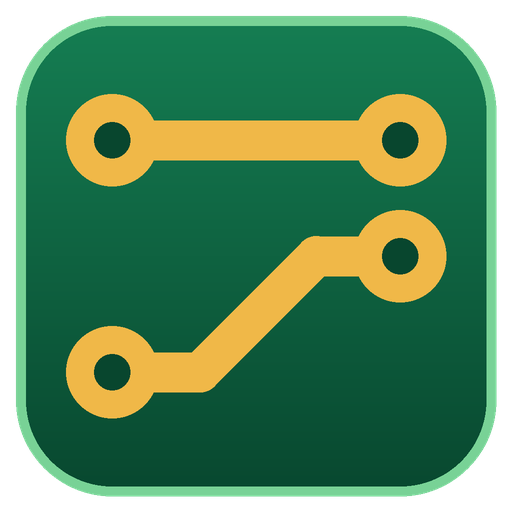
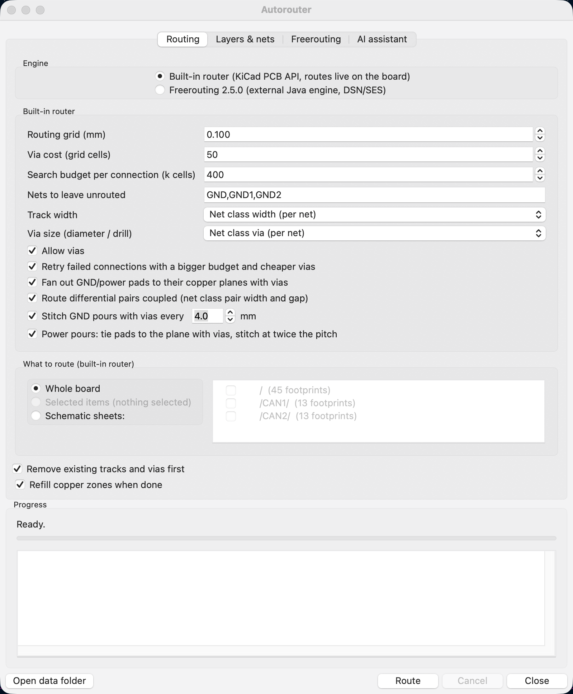
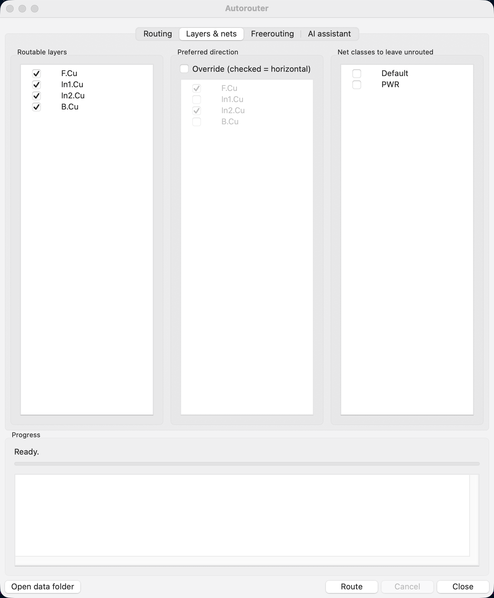
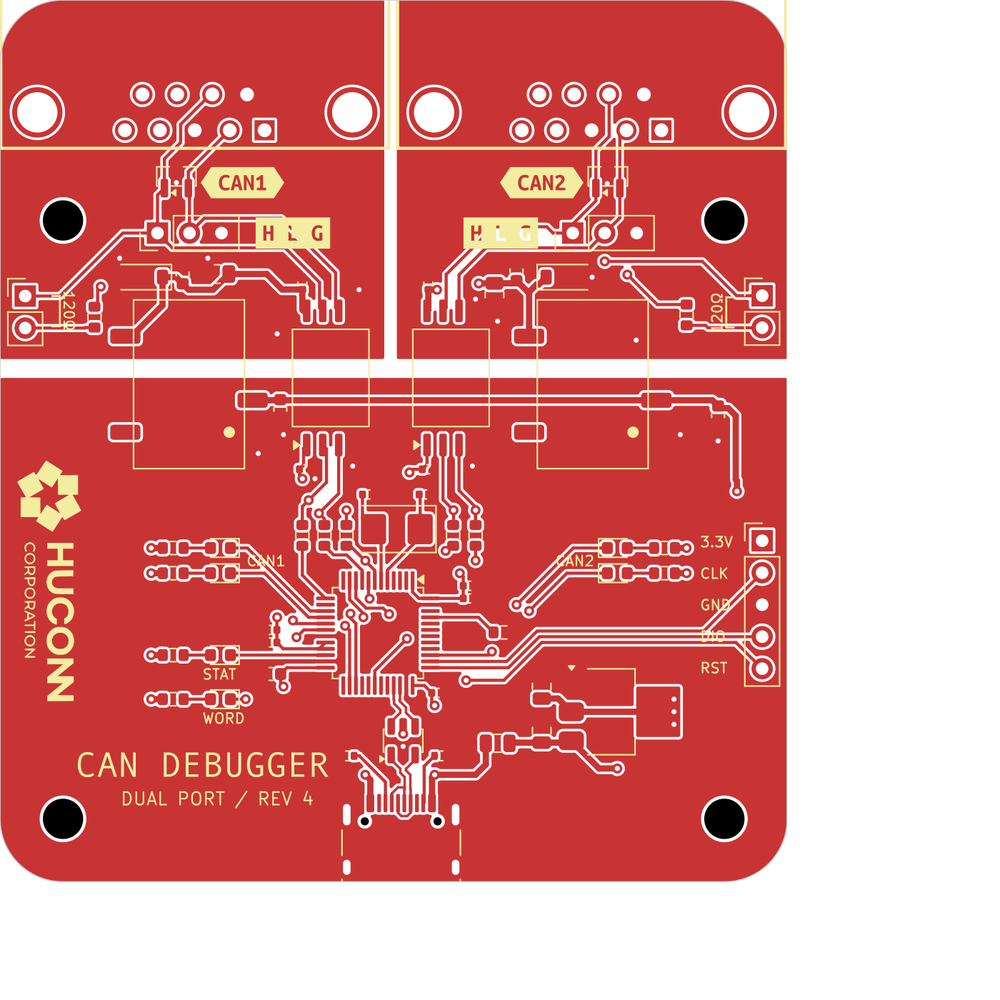
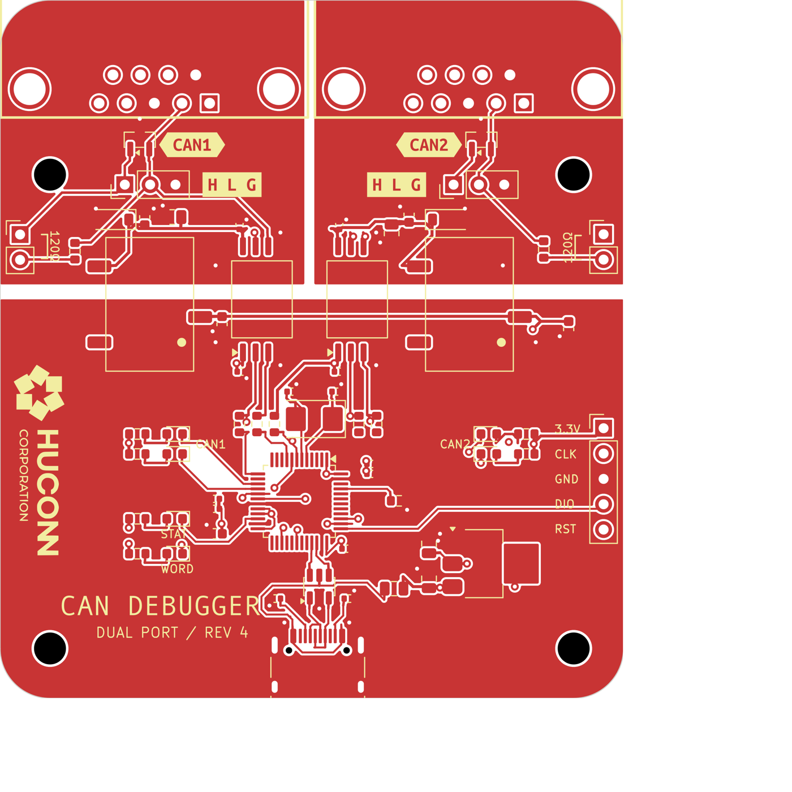
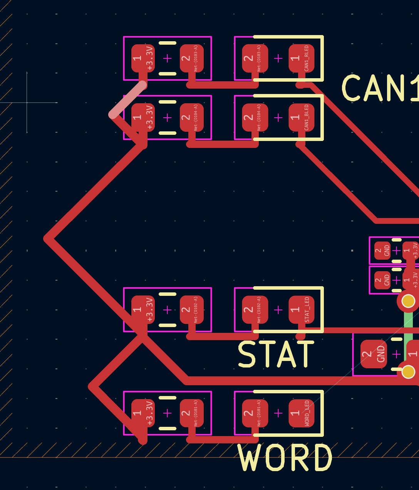
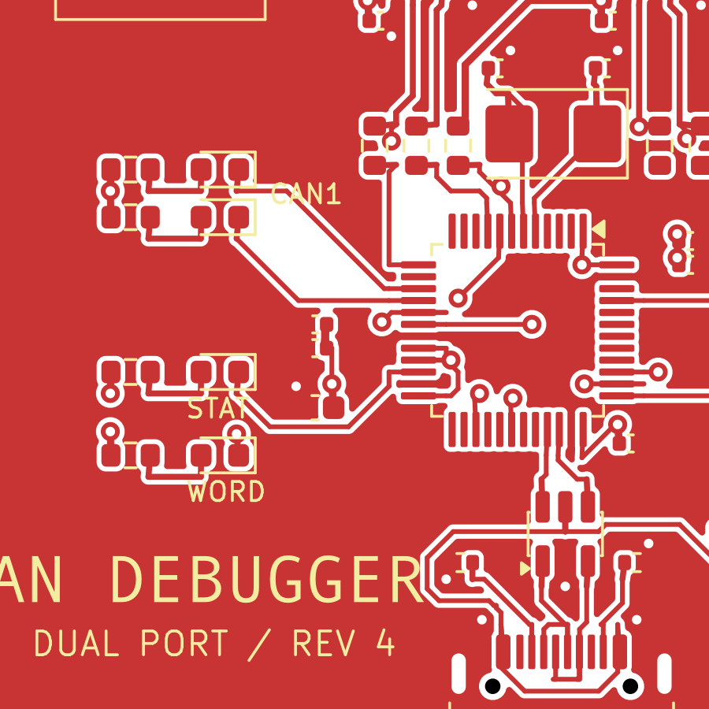
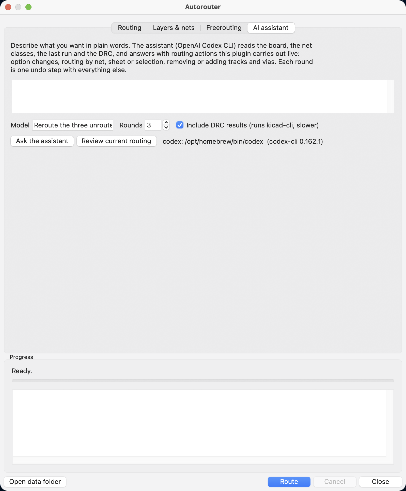

# KiCad Autorouter



Autoroute the open board without leaving KiCad's PCB editor. One toolbar
button opens a dialog with the router and an AI assistant:

- **Built-in router**. Reads pads, existing copper, keepouts, the
  board outline and the net-class rules through KiCad's PCB API, routes on a
  multi-layer grid with A* and rip-up, and puts each connection's tracks and
  vias on the board **as soon as it is found**. No files, no external
  programs, one undo step. It escapes pads along their axis, necks down at
  fine-pitch pins, routes differential pairs coupled, fans GND/power pads out
  to their planes, stitches pours with vias and refills the zones.
- **AI assistant**. Hands the board to the OpenAI Codex CLI and carries out
  what it answers: option changes, routing by net, sheet or selection,
  removing or adding tracks and vias, with the DRC fed back each round.



## 0.3.0 routing improvements

- Check signal vias against their actual barrel-sized clearance maps, avoiding
  a second grid-radius expansion that could close legal escape sites.
- Reconnect isolated copper after signal routing and power-plane repairs.
- Include the copper footprint when applying temporary keepouts, and preserve
  fine-pitch pin via sites during rip-up searches.

On the four-layer regression board, the three deterministic search budgets
went from **20 / 15 / 13 unconnected items to 0 / 0 / 0**, with no added KiCad
physical or rule errors and identical final geometry. Four pre-existing hole
clearance errors remained. This is a routing regression result, not fabrication
or signal-integrity approval. The offline and GUI suites passed on KiCad 10.0.7
on macOS; live AI service tests were not part of this release check.

## Requirements

- KiCad 9.0 or 10.0 (the SWIG action-plugin API). KiCad 11 drops that API; an
  IPC-API build is on the roadmap.
- The router needs nothing else.
- The AI assistant needs the `codex` CLI (`npm i -g @openai/codex`), logged in.
- macOS (Apple Silicon and Intel), Windows x64, Linux x64/arm64.

## Installation

### With the Plugin and Content Manager (recommended)

The plugin is published in its own PCM repository, so KiCad installs it, shows
when a newer version is out and updates it for you.

**1. Add the repository (once)**

1. Open the **KiCad** project manager (the main window, not the PCB editor)
   and click **Plugin and Content Manager** in the launcher on the right
   (also under **Tools → Plugin and Content Manager**).
2. Click **Manage…** next to the repository dropdown at the top.
3. Click **+** (*Add repository*), paste this URL and confirm with **OK**:
   ```
   https://raw.githubusercontent.com/hulryung/kicad-autorouter-pcm/main/repository.json
   ```
4. Click **Save** to close the repository list.

**2. Install**

1. In the repository dropdown, choose **KiCad Autorouter Repository**.
2. On the **Plugins** tab, select **Autorouter** and click **Install**.
3. Click **Apply Pending Changes** (bottom right) and close the manager.

**3. Run it**

1. Open a board in the PCB editor. The **Autorouter** button (the green board
   with gold traces) is on the top toolbar, and the plugin is under
   **Tools → External Plugins → Autorouter**.
2. If the button is not there, use **Tools → External Plugins → Refresh
   Plugins**, or restart KiCad.

**Updating and removing**

- When a new version is published, the manager shows **Update** next to
  Autorouter (on the **Installed** tab too). Click it, then **Apply Pending
  Changes**.
- To remove the plugin, click **Uninstall** on the **Installed** tab, then
  **Apply Pending Changes**. Your settings and job logs stay in the data
  folder (see [Data folder](#data-folder)).

**Troubleshooting**

- *The repository does not show up in the dropdown*: check the URL (it ends
  in `repository.json`) and that KiCad can reach `raw.githubusercontent.com`
  (proxy settings in **Preferences → Preferences → Common**).
- *"Package not compatible"*: the plugin needs KiCad 9.0 or 10.x.
- *Installed but no button*: some KiCad builds hide plugin buttons until the
  plugin is enabled under **Preferences → PCB Editor → Action Plugins**;
  tick **Show button** for Autorouter.

#### 설치 방법 (한국어 요약)

1. KiCad 메인 창에서 **플러그인 및 콘텐츠 관리자**(Plugin and Content Manager)를 엽니다.
2. 상단의 **관리…**(Manage…) → **+** 를 눌러 아래 주소를 추가하고 **저장**합니다.
   `https://raw.githubusercontent.com/hulryung/kicad-autorouter-pcm/main/repository.json`
3. 저장소 목록에서 **KiCad Autorouter Repository** 를 고르고, **Plugins** 탭의
   **Autorouter** → **설치**(Install) → **변경 사항 적용**(Apply Pending Changes).
4. PCB 편집기 상단 툴바의 Autorouter 버튼(초록 보드에 금색 트레이스)을 누릅니다.
   보이지 않으면 **도구 → 외부 플러그인 → 플러그인 새로 고침** 또는 KiCad 재시작.
5. 새 버전이 나오면 관리자에 **업데이트** 버튼이 표시됩니다.

The source repository is private; the PCM repository above holds only the
installable packages and their metadata. After updating `__version__` and
`metadata.json`, maintainers can prepare a release locally:

```bash
python3 scripts/build-package.py
python3 scripts/publish-pcm.py --no-push  # build and commit the local PCM checkout
```

Review the package and the distribution commit before running
`python3 scripts/publish-pcm.py` to publish. `--no-push` does not make the new
version available in other users' PCM catalogues. The ZIP can already be shared
and installed directly; its build summary includes the SHA-256 checksum.

### From a zip

`python3 scripts/build-package.py` writes `release/kicad-autorouter-<version>.zip`;
**Plugin and Content Manager → Install from File…** installs it.

### For development

```bash
git clone https://github.com/hulryung/kicad-autorouter
cd kicad-autorouter
./scripts/install-dev.sh      # symlinks plugins/autorouter into KiCad 9/10's scripting/plugins
touch plugins/autorouter/.devreload   # optional: reload edited modules on every run, no KiCad restart
```

Then **Tools → External Plugins → Refresh Plugins** in the PCB editor.

## Using it

Open a board, click **Autorouter**, click **Route**. Options
are remembered between runs, and every run is one undo step (Ctrl+Z puts the
board back exactly as it was).

| Tab | What you set |
|-----|--------------|
| **Routing** | Four groups. *Search*: routing grid pitch, via cost, search budget per connection, a **time limit** for the whole run (default 10 minutes: what is routed stays, the rest is reported as not routed, pour vias are still placed), nets to leave to the pours (patterns such as `GND,*_PLANE`). *Track and via sizes*: **track width** (automatic, net class, the editor's current choice, or any pre-defined size), **via size**, vias on/off, retry pass, **fanout vias** for GND/power pads, **coupled differential pairs**, **GND via stitching** with its pitch, **power pours** (pad vias and coarser stitching), **nets with a copper pour under their pads** (treated as planes: vias to the pour, no tracks), **move existing tracks** (shove: unlocked tracks already on the board may be ripped up and rerouted when a connection finds no room, like the interactive router), and **what to route**: the whole board, the items selected in the editor, or the footprints of chosen schematic sheets. *Existing tracks*: keep them and route only the unconnected (ratsnest) connections, which is the default every time the dialog opens, or remove all tracks and vias first; and whether to refill the zones when done. |
| **Layers & nets** | Which copper layers may be routed, an optional preferred-direction override per layer, and net classes to leave unrouted. |
| **AI assistant** | A request in plain words, the model, the round limit, whether to include the DRC, and the **Review current routing** button for a critique without changes. |



### What the result looks like

A finished 4-layer board (71 footprints, 75 nets, DRC clean) with all its
tracks removed and rerouted by the built-in router, GND left to the pours:

| Original artwork | Rerouted by the plugin |
|---|---|
|  |  |

The cost model and the pad escapes matter for how the result looks. The LED
resistors below were first routed with a flawed diagonal cost (left: a
zig-zag "bus") and, after the fix plus escapes toward the net's nearest pad,
as a designer would draw them (right):

| Before | After |
|---|---|
|  |  |

Benchmark figures for that board (GND nets excluded), from
`tests/test_native_e2e.py`:

| | Original | Built-in router |
|---|---|---|
| Signal connections (+3V3 is a plane net: vias, no tracks) | – | 76 of 78 routed |
| Unconnected items after refill (KiCad DRC) | 0 | 2 (the open signals) |
| DRC violations | 0 | 0 |
| Track segments | 353 | 598 |
| Track length | 764 mm | 801 mm |
| Vias | 46 | 102 (72 of them pad-to-plane fanout) |
| Stitching vias (GND pours, 4 mm) | – | 154 |
| Segments doubling back over a stub | 1 | 0 |
| Segments off the 0/45/90-degree grid | 0 | 0 |
| Time | – | 130 s |

The +3V3 net has a plane on an inner layer, so the router treats it like GND:
every +3V3 pad gets a via to the plane (or a short link to a neighbouring
pad that has one) and no +3V3 tracks are drawn. Those pad vias go in before
the signals, as a designer places the decoupling vias first. With that, the
26 power pads and all GND pads end up connected; two signal connections on
QFP pins whose both sides are taken stay open (which two varies between
runs: WORD_LED, CAN2_RX_CAP or CAN2_TX_CAP).

Every segment lies at 0, 45 or 90 degrees, as hand-drawn copper does: the
stub from a pad centre to its exit cell takes up the sub-grid offset with a
45-degree jog hidden inside the pad (or at the exit when the lane next to
the pad is too tight), and the run from an exit to a fanout via is drawn the
same way. The segment count went up by the jogs.

The last row counts same-net segments running back over each other, a route
that left a pad through its stub and came straight back: 97 of them before
the escape side was chosen by the room beyond the pad (the designer takes a
QFP pin under the body to a via when a part sits right outside the row),
outlets past each exit were kept clear of neighbours' vias and tracks, and
shared stubs were written once. The 22 routed pins of the MCU now leave on
the same side as in the original artwork for 19 of them.

## KiCad's routing settings

The built-in router takes its sizes from the board the way KiCad's own tools
do:

- **Net classes**: track width, clearance, via diameter and drill come from
  each net's effective net class. Board minimums (track width, via size,
  clearance, hole clearance, hole-to-hole) are enforced on top.
- **Per-item clearances**: pads and tracks with local clearance overrides are
  kept at that distance.
- **Automatic track width** (the default): the width the net's existing
  tracks already use wins; else, for power nets (names like `+3V3`, `VBUS`,
  `VCC*`, `*_PWR`), the widest pre-defined width that still fits the net's
  narrowest pad, never below the net class; else the net class width. On the
  benchmark board this reproduces the original designer's width on 37 of 43
  nets. Fine-pitch connections are necked only within 1.5 mm of the pin and
  widen after that.
- **Pre-defined sizes and the editor's selection** are offered as alternatives
  for track width and via size.
- **Differential pairs**: nets paired by name (`D+/D-`, `TX_P/TX_N`,
  `USB_DP/USB_DN`) take the pair width and gap of their net class, which is
  where KiCad keeps the impedance choice (Board Setup > Net Classes), and are
  routed coupled: one search for the pair's centreline, then the two tracks a
  gap apart, each joined to its pad with a straight run and a 45-degree step.
  When the pins are in opposite order at the two ends (P above N at one part,
  below it at the other), the pair still runs coupled with a **via swap**: on
  a straight stretch of the run, at least 1 mm from either end, one line
  drops through a via, crosses under its partner at 45 degrees on another
  layer (an outer layer first, so a plane stays whole) and comes back up,
  while the partner steps across on the run's layer.
  A coupled run of 8 mm or more may also change layers: the two lines flare
  out at 45 degrees to a **via pair** set square across a straight stretch of
  the run, and close up again beyond it; a via pair sits at least 1 mm from
  the pins and 2 mm from the next one. A run stays on one layer where it can
  (each via pair costs three times a via), with one exception: when the pins
  are the other way round at one part, the run turns about through a via
  pair beyond that part's pins, as a designer takes a pair into the inner
  row of a two-row connector: the router picks the first spot out along the
  pins' escape where the via pair and a straight lead back to the pins fit,
  the search aims at it from the pins' side (passing under the pin rows on
  another layer), and each line keeps its side of the board through the
  turn, so the order comes out right without a swap.
  When the run fits but an end does not let both lines in side by side (a
  crowded QFN, a connector's staggered through-hole pins), the coupled run is
  kept, stops short of that end (about 1 mm, further where big pads need it;
  both ends if neither lets the pair in), and each line is finished to its
  pin single-ended; the result
  notes which end of which pair ("coupled, the U304 end connected
  single-ended"), so it can be checked by hand. Only if that fails too is
  the pair routed separately.
  Pairs whose ends are closer than 3 mm, or that find no room for a run, a
  via pair or a swap, are routed separately, and the log says why.

Not read yet: custom DRC rules (`.kicad_dru`) that set track width or via size
per condition (their clearances are honoured through the per-item clearance).
Impedance widths, pairs and length matching are set on the Signal integrity
tab instead (next section), which can also write such rules.

### Hand-drawn habits

A few things the router does the way a designer would, before and after the
search:

- **Direct links**: two pads of a connection within 5 mm of each other, on a
  shared layer, with a clear straight line (or one 45-degree jog) between
  them, are joined pad to pad before the search: a resistor facing its LED,
  a decoupling capacitor beside the IC pin it serves. They are drawn once the
  differential pairs have their runs, and the whole width of the link keeps
  out of other pads' outlet lanes, so a wide power link across a pin field
  cannot take the room a pair needs to leave its pins side by side.
- **Outward exits on two-pin parts**: a chip resistor, capacitor or LED pad
  may also be left straight out of the part's end, not only off the ends of
  the pad's long side, so a track does not leave sideways and loop back.
- **No acute corners**: where a route would turn back by more than 90 degrees
  (a pad stub up, then a diagonal down and away), the corner is cut with a
  0/45/90-degree run straight onto the next segment, or past a few small
  snapping steps, wherever that is clear.

## Signal integrity: impedance, pairs, length matching, routing order

The **Signal integrity** tab holds what the net classes cannot say. It is
saved next to the board as `<board>.autorouter.json`, so it travels with the
project.

- **Stackup**: the board's own (Board Setup > Physical Stackup) or one of
  JLCPCB's standard 1.6 mm builds: 2-layer, 4-layer with 7628, 3313 or 2116
  prepreg (`JLC04161H-*`), and 6-layer with 2116 or 3313 (`JLC06161H-*`). The
  template values are JLCPCB's published ones as far as known; order with
  impedance control for exact widths.
- **Controlled impedance**: classes of nets (name patterns) with a
  single-ended and/or differential target, e.g. USB 90 ohm differential,
  Ethernet or LVDS 100 ohm, RF 50 ohm (presets are in the "Add preset" menu).
  The width each copper layer needs is computed from the stackup: microstrip
  (Hammerstad-Jensen, with a solder mask correction) on the outer layers,
  stripline (Wheeler, between the nearest copper layers) inside, and
  IPC-2141 coupling for pairs. A pair's gap is the track width up to 0.2 mm
  unless you set one. The router then draws each segment at its own layer's
  width (pad escapes may still neck down at fine-pitch pins), and a coupled
  pair at the pair width and gap of the layer it starts on. The widths are
  shown under the stackup ("Compute sizes"). On JLC04161H-7628, for example,
  50 ohm is 0.365 mm on the outer layers and 90 ohm differential is
  0.300/0.200 mm.
- **Differential pairs into KiCad**: "Write to KiCad" creates a net class per
  impedance class (track width, diff pair width and gap, with the patterns
  assigned), so KiCad's interactive and differential pair routers (keys X
  and 6) use the same sizes. It also writes rules into the project's
  `.kicad_dru`, between marker comments, keeping the rest of the file:
  per-layer track width and pair gap, maximum uncoupled length, skew per pair,
  and a length window per length group. KiCad's DRC and its length tuner then
  check against the same targets.
- **Pair exceptions**: a pair that cannot or need not run coupled is
  connected directly instead, and the log says why: ends closer than 3 mm
  (coupling does not matter over such a short run, e.g. a USB connector to its
  ESD part), pins in opposite order at the two ends with no room for a via
  swap, ends on different layers, or no room. Each line then takes the most direct route it can, with vias
  three times as costly. If the whole pair is no longer than the allowed
  uncoupled length (5 mm), its skew is not matched either. "Write to KiCad"
  adds a rule after the class rules that lifts the coupling, gap (and, for
  such short pairs, skew) limits for exactly those pairs. Both thresholds are
  on the Signal integrity tab.
- **Length matching, with KiCad's length tuner**: groups of nets (a memory
  byte lane, an address bus, QSPI, RGMII...) with a tolerance and an optional
  target (default: the longest member). Pairs of an impedance class with a
  skew are matched to that skew. Lengths are measured the way KiCad's tuner
  and DRC do, via heights through the stackup included. After routing, the
  shorter nets get meanders on a straight run with room for them (checked
  against pads, tracks, vias, keepouts and the board edge at the net's
  clearance). Each net's meander is then handed to KiCad as a native **tuning
  pattern** (the object Route > Tune Length makes), with the group's target
  window and KiCad's pattern settings (Board Setup > Length-tuning Patterns).
  When the dialog closes, the plugin runs KiCad's **Edit > Update All Tuning
  Patterns**, so the final meanders are built by KiCad's own engine; drag a
  pattern's handles or change its target to retune it by hand. Where KiCad
  finds no room, the pattern shows "too short", and one Ctrl+Z (that update is
  its own undo step) brings the router's meanders back. Python cannot create
  tuning patterns directly, so the plugin loads them from a small temporary
  board file and moves them onto your board. The log reports each group's
  spread before and after.
- **Routing order**: nets are sorted into groups and routed group by group,
  most important first: differential pairs, memory (nets on DDR/SDRAM/PSRAM/
  flash parts, found by part value, and DQ/DQS/FMC-style names), high speed
  (USB, Ethernet, MIPI, SDIO... and every net with an impedance or length
  rule), clocks and crystals, routed power nets, everything else. Reorder the
  list with Up/Down. Within a group fine-pitch escapes go first, then the
  shortest. During rip-up a later group may not move a pair, memory or
  high-speed route.

## Routing part of a board

*What to route* on the Routing tab:

- **Selected items**: select footprints, pads, tracks or vias in the editor
  before opening the dialog. Connections that touch a selected footprint, and
  all connections of a selected track's or via's net, are routed.
- **Schematic sheets**: tick one or more sheets. Connections touching a
  footprint from those sheets are routed.

Only the chosen connections are searched; the rest of the board stays an
obstacle.

## How the built-in router works

1. **Read** (PCB API, a few seconds): every pad, track, via, keepout and copper
   graphic is rasterized onto one occupancy grid per distinct (track width,
   clearance) pair, already inflated by the clearance plus half the track
   width (plus a 10 µm safety margin), so the search only asks "may this net's
   centreline pass here?". Pads of the same net already joined by copper form
   clusters; the connections to route are a minimum spanning tree over each
   net's clusters, like KiCad's ratsnest.
   - **Pad escapes**: SMD pads are left along the pad's long axis to an exit
     point just past the pad end, towards the net's nearest pad on another
     footprint when that lane is free (a chip's power pin heads for its
     decoupling capacitor, not for the same-net pin round the corner of the
     chip); each lane is checked with KiCad's own shape collision tests and
     lanes are kept clear of each other. When the board past the preferred
     side is boxed in (a crystal or resistor right outside a QFP row) and
     the other side is open, the pad leaves the open side, as a designer
     takes a pin under the body to a via; not when the target pad itself
     sits in that lane within 2 mm (the capacitor right below an SOIC pin,
     whose ground pad beside the lane makes it look boxed in). The first 0.6 mm past an
     exit is an **outlet**: other nets' vias may not sit on it and their
     tracks pay a penalty to cross it, so a neighbour cannot wall a pin in.
     The side chosen when the job starts is kept for the whole job: the
     pad vias placed first would otherwise make the open side look boxed in
     on the next pass and send the track out the far end of the pad and
     back around it. In the second pass a stubborn pad gets exits on both
     ends and the search picks one.
   - **Fine pitch**: connections that end on fine-pitch pins (neighbours
     closer than width + 2 × clearance) are routed first and at the board's
     narrowest pre-defined width for their whole length.
2. **Route** (worker thread): multi-source, multi-layer A* (8 directions, no
   corner cutting, preferred direction per layer, a diagonal costs its share
   of the against-direction penalty so runs do not zig-zag, via cost, turn
   penalty). A connection that cannot be routed gets a **rip-up and reroute**
   pass: a search that may cross paths this run created (never fixed copper)
   at a penalty, those paths are removed, the connection is routed, and the
   removed ones are rerouted. With **Move existing tracks** on, the board's own
   unlocked tracks and vias of routable nets enter the run as such paths too,
   so a blocked connection can shove them aside the way KiCad's interactive
   router does; locked tracks and pour nets never move. Zig-zag runs are straightened into one straight
   and one diagonal piece. Differential pairs go first, as one coupled route.
   Connections still open after that get a **second pass** on their own: half
   the grid pitch, the board's narrowest pre-defined width, cheaper vias, in a
   run scoped to just those nets, the way a designer finishes the last
   stubborn connections by hand. That pass has its own budget (60 s plus
   20 s per open connection), since the finer grid has four times the
   cells. The whole job runs under the **time
   limit**, checked inside each search as well as between connections: a big board whose rip-up rounds would grind for hours instead
   stops with what it has, reports the rest as not routed, and still places
   the pour vias.
0. **Plane nets first**: a net whose copper pour lies under at least half of
   its pads (a +3V3 inner plane, a local power pour) is a plane net like GND:
   it gets no tracks, each pad gets a via to the pour, straight off the pad
   escape where a via fits, else by a short search within 3 mm, else a link
   to the nearest copper of the net that already has one (two adjacent QFP
   power pins share a via). These pad vias are placed before the signals are
   routed, as the decoupling vias are in a hand layout. Off with **Nets with
   a copper pour under their pads** in the dialog (`plane_nets` for the AI).
3. **Finish**: pads of unrouted pour nets get **fanout vias** to their planes,
   pours spanning two or more layers get **stitching vias** where a return
   path needs one: on the grid of the chosen pitch, but only beside a
   signal's layer change or a pour net's own via (a blanket of vias is not
   what a designer does), both
   only where a via still fits and only where no via of that net sits already
   (a second run, or a scoped AI route call, adds none twice); copper zones
   are refilled. The pours come last on purpose: a via dropped first would
   sit in the escape lanes the signals need.
4. **Apply** (PCB API, main thread): each path becomes `PCB_TRACK` segments and
   through `PCB_VIA`s, added to the open board as it is found; ripped-up paths
   are removed again. Copper the net already has on that layer (a pad stub
   shared by two routes, a run along an earlier route of the net) is written
   once: new segments are trimmed against it. KiCad records the whole run as
   one undo step.

Limits: through vias only; filled zones are not obstacles (they are refilled
around the new tracks, so pour nets belong under *Nets to leave unrouted*); the
grid is uniform, so very fine-pitch parts want a smaller pitch (slower).

## AI assistant (Codex)



The **AI assistant** tab hands the board to the OpenAI Codex CLI and carries
out what it answers. Write the request in plain words ("route the whole board,
leave GND to the pours, keep the USB pair coupled, then fix what the DRC
reports"), or press **Review current routing** for a critique without changes.

Each round the plugin writes `board-context.json` (board size and layers,
rules and pre-defined sizes, net classes, every net with its pads, class,
tracks, pours and pair partner, footprints per sheet, the options, the last
run's outcome, and KiCad's DRC on a refilled copy) and runs

```
codex exec --skip-git-repo-check -s read-only --ephemeral --output-schema <schema> -o <reply> -
```

with the request, the context and a rendered image of the board on stdin.
The model must answer with a JSON object (schema enforced by Codex): a
`summary`, `done`, and `actions`:

| Action | What it does |
|---|---|
| `set_options` | change routing options for the next route (grid, via cost, skip nets, widths, layers, fanout, stitching, pairs, move_existing, plane_nets, time_limit_min, ...) |
| `route` | run the built-in router on the board, a list of nets, schematic sheets or the selection, with hints: allowed `layers`, a fixed `width_mm`, `via_cost`, `avoid_mm` rectangles |
| `remove_tracks`, `remove_items_near` | delete a net's copper, or the tracks/vias around a point |
| `add_track`, `add_via` | draw copper by hand (polyline in mm, via at a point) |
| `move_footprint` | move, rotate or flip a part |
| `move_items_near`, `set_track_width`, `set_layer_near`, `set_via_near` | shift existing tracks/vias, change widths, move segments to another layer, resize vias |
| `inspect_near` | list the tracks, vias, pads and footprints around a point (returned to the model) |
| `refill_zones`, `note`, `ask` | refill pours, leave a remark, ask the user (the loop stops) |

The model sees the board as data: nets, classes, footprints, sheets, the last
run, KiCad's DRC and an `unconnected` list with both end pads and positions of
every open connection, so it can aim its inspections and edits at exact
coordinates. The plugin applies the actions on the open board through the
built-in router with live display. **Every edit is measured**: KiCad's DRC and the unconnected
count are taken before and after, hand edits that add violations are rolled
back automatically (unless the model sets `force` because a later action will
fix it), and each round's results, the `failed_detail` of connections that
could not be routed (how much room there is around each end and which nets
block it), a fresh DRC and a new board image go back to the model, up to the
round limit or until `done`. The whole session stays one undo step. The
sandbox is read-only and the working directory is the plugin's job folder
(context, prompts, replies, images and `rounds.json` stay there), so the
model can read the context files but nothing else is touched.
`docs/ai-routing-approach.md` explains the design and the plan for it.

**Score and improve** turns the assistant into a reviewer: the model scores
the current routing 0-100 overall and per criterion (connectivity, DRC, track
length, vias, layer use, aesthetics, signal integrity, power and ground) from
the context, deterministic metrics (length, segments, vias, detour ratio per
net, octilinear share), a full-board render and close-ups of the places it
flagged in the previous round, lists issues with positions, applies the
actions it proposes under the same DRC verification, and re-scores, until it
says it is done, the score stops rising or the round limit is reached. The
score card and the rounds are kept in `review-rounds.json` in the job folder.

## How it is built

```
plugins/autorouter/
  __init__.py        registers the action plugin (skipped outside the PCB editor)
  plugin.py          pcbnew.ActionPlugin: the toolbar button (.devreload hook for development)
  dialog.py          wx dialog: options, scopes, progress, the AI tab
  settings.py        settings.json in the data folder
  engine/
    native/          the built-in router
      extract.py     board -> RoutingProblem through pcbnew (pads, copper, keepouts, outline, rules,
                     escapes, pairs, fanout and stitching candidates, scopes)
      grid.py        multi-layer owner grid and rasterizers
      astar.py       one connection: multi-source, multi-layer A*, soft mode for rip-up
      router.py      all connections: order, rip-up, pairs, straightening, fanout, stitching
      apply.py       RoutedPath -> PCB_TRACK / PCB_VIA on the board
      problem.py     the data model shared by the above
    ai/              the Codex assistant: context.py, codex.py, actions.py, assistant.py, headless.py
    options.py       RouteOptions: what the dialog remembers between runs
    session.py       pcbnew helpers: layers, net classes, zone refill, track removal, job folders
    paths.py         data folder and platform names
```

Only `extract.py`, `apply.py`, `session.py`, `context.py`, `plugin.py` and
`dialog.py` import pcbnew or wx; everything else runs and is tested with a
plain Python.

### Data folder

| OS | Path |
|----|------|
| macOS | `~/Library/Application Support/kicad-autorouter` |
| Windows | `%LOCALAPPDATA%\kicad-autorouter` |
| Linux | `$XDG_DATA_HOME/kicad-autorouter` (default `~/.local/share/kicad-autorouter`) |

It holds `jobs/` (each run's files: the run log, the AI context, prompts and
replies; last 10 kept), `logs/` and `settings.json`.
A built-in run's `jobs/<time>-<board>/dialog.log` is a timestamped trace of
the run (board reading, one progress line a second with the stage: routing,
rip-up round, second pass, fanout, stitching; the outcome), so a run that
looked stuck can be read afterwards. The **Open data folder** button opens it.

## Tests

```bash
python3 scripts/run-tests.py        # offline: router core on synthetic grids (incl. a coupled pair, a via swap, a pair via, the time limit),
                                    # settings, AI schema and loop (fake codex)
# with KiCad's Python the end-to-end tests run too:
/Applications/KiCad/KiCad.app/Contents/Frameworks/Python.framework/Versions/Current/bin/python3 scripts/run-tests.py
# the built-in router on any board, with KiCad's DRC and artwork statistics:
<KiCad python3> tests/test_native_e2e.py path/to/board.kicad_pcb --skip GND --out /tmp/routed
# the assistant against the real Codex CLI (opt-in):
KICAD_AUTOROUTER_AI_LIVE=1 <KiCad python3> tests/test_ai_live.py [board] [request]
```

## Improving the router with Claude Code

`scripts/improve-loop.py` runs a closed loop on a finished reference board
(by default the CAN-debugger board this README benchmarks):

1. **Benchmark** (`scripts/improve_bench.py`, KiCad's Python): a copy of the
   reference is stripped of its tracks and routed by the code under test.
   It writes `metrics.json` with the open connections, DRC by type, dangling
   tracks, off-45-degree and doubled-back segments, length, vias, and how
   many pins of the larger parts leave on the same side as the reference.
   It also writes images: the whole board and close-ups of every problem and
   of the largest parts, each next to the same view of the reference. Time
   budgets are off and the hash seed is fixed, so the same code gives the
   same result.
2. **Evaluate**: `claude -p` reads the metrics and looks at the images, and
   answers with a score, per-criterion marks, issues with board positions
   and their likely cause in the router, and the one change it would make
   next.
3. **Improve**: `claude -p` edits `plugins/autorouter/engine/native/` in a
   separate git worktree, given the evaluation and what earlier rounds tried.
4. **Verify**: the unit tests and the benchmark run again. The change is
   committed on the loop's branch only if a deterministic penalty drops
   (open connections and DRC errors weigh most, then dangling and odd-angle
   copper, escape-side disagreements, length and vias, and slowness) and
   nothing hard gets worse. Otherwise the worktree is reset.

```bash
python3 scripts/improve-loop.py --rounds 3                 # CAN-debugger, GND nets left to the pours
python3 scripts/improve-loop.py --reference path/to/board.kicad_pcb --skip GND,+3V3 \
        --goal "pins of U1 should escape like the reference" --model opus --budget-usd 5
```

With a design intent (`--intent file.json`, the same format as
`<board>.autorouter.json`; `examples/<board>.intent.json` is picked up by
default and `--intent none` turns it off) the benchmark routes with those
impedance classes, length groups and routing order, writes them into the
routed copy's net classes and `.kicad_dru`, and measures them: the share of
controlled track length at the right width, each pair's coupled share and
skew, each length group's spread, open nets per routing group, and KiCad's
rule violations (gap, skew, length, width) apart from the physical DRC
errors. The reviewer scores those under four more criteria
(impedance_widths, diff_pairs, length_matching, routing_priority, 0-10 each,
next to connectivity, drc, similarity, escapes, directness, vias and
neatness, and the 0-100 overall score), and they enter the penalty too.

Everything lands in `.improve/<time>/`: each round's benchmark and images,
the evaluation and improvement transcripts, the patches (kept or not), and
`report.md` with a table of the rounds. The reference board is only read and
your checkout is not touched; the kept changes are on the branch
`improve/<time>`, to review with `git diff main...improve/<time>` and merge or
delete (`git worktree remove .improve/<time>/worktree`).

## Roadmap

- Built-in router: a congestion analysis for failed connections, blind/buried
  vias, zone-aware routing, reference-artwork style profiles once reference
  boards are available.
- AI assistant: a rendered board image per round, waypoint and layer-preference
  routing primitives with DRC-checked rollback (see `docs/ai-routing-approach.md`).
- **KiCad 11 / IPC API build.** KiCad 11 removes the SWIG plugin API; the
  router's board reading and track writing move to `kicad-python`.

## License

MIT.
