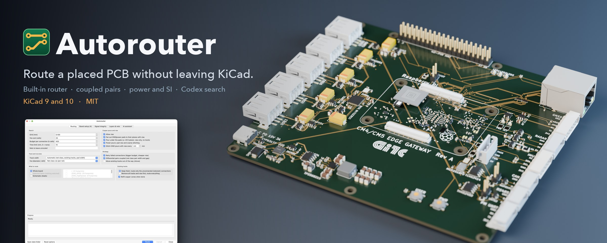
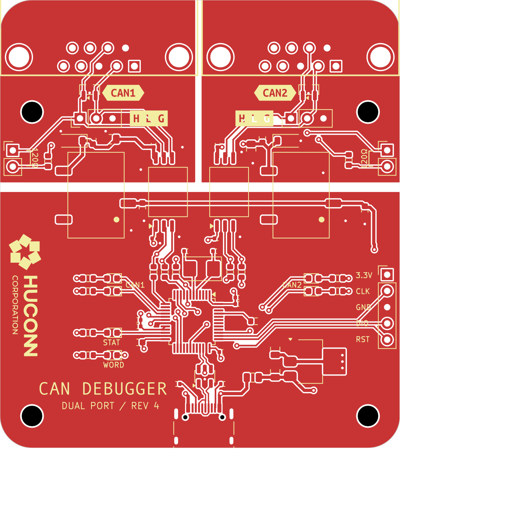
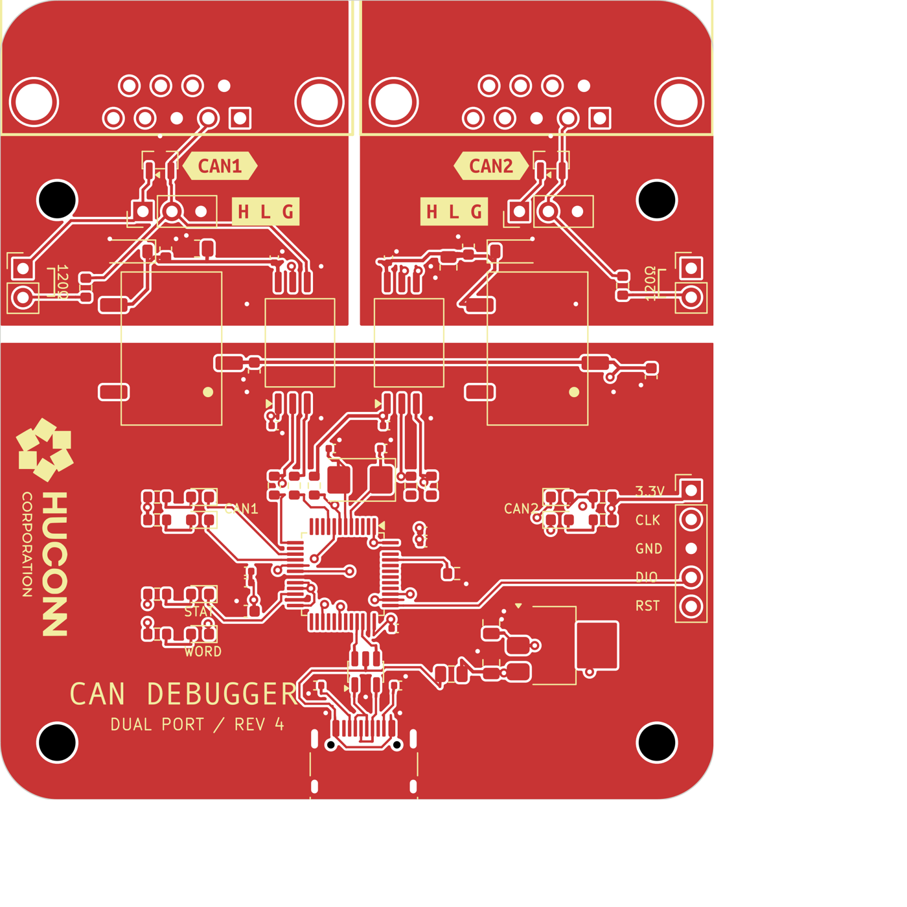
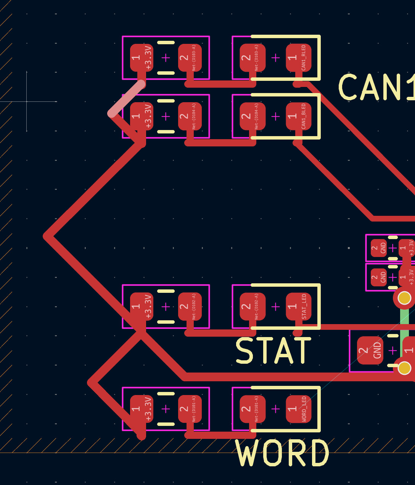
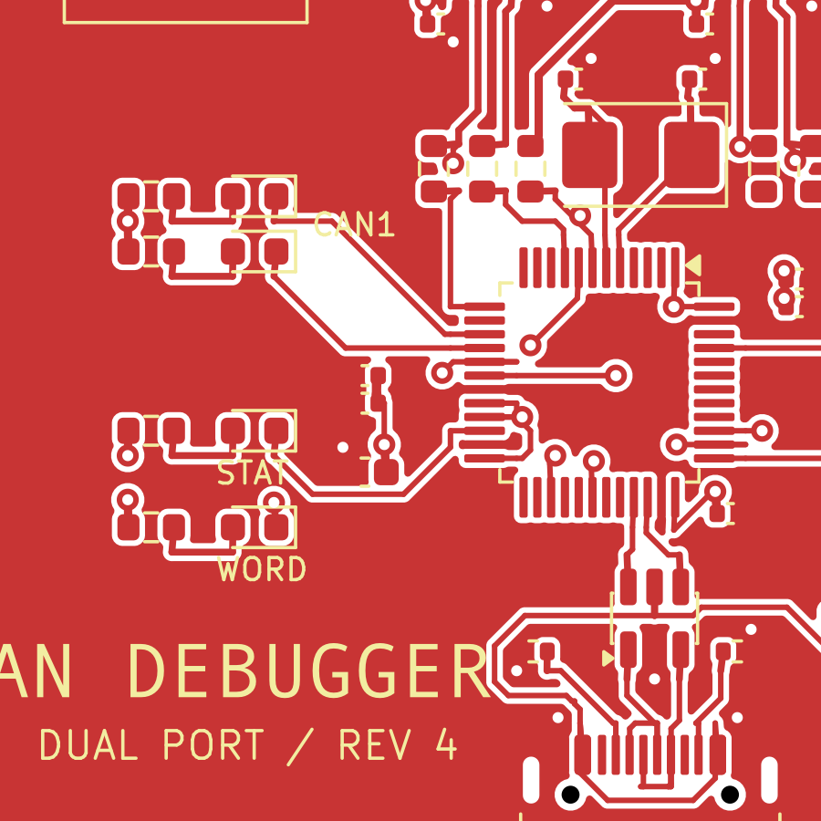

# KiCad Autorouter



Route a placed PCB without leaving KiCad. Autorouter adds a toolbar button
with a built-in router, signal-integrity settings and an optional AI assistant.
The built-in router runs locally using KiCad's board model; no external routing
service or AI account is required.

**Current release:** [0.5.6 — testing / pre-release](https://github.com/hulryung/kicad-autorouter/releases/tag/v0.5.6)

**KiCad:** 9 and 10 · **License:** [MIT](LICENSE)

## What is implemented

| Area | Capabilities |
| --- | --- |
| Routing | Multi-layer A* search, rip-up and reroute, fine-pitch pad escapes, neck-down, short direct connections and a finer retry pass for unfinished nets. |
| Existing boards | Route remaining connections, route selected items or schematic sheets, or explicitly remove existing tracks first. Optional movement of existing unlocked copper through rip-up and reroute. |
| Board rules | Net-class and board minimum sizes, local clearances, keepouts, board edges, selectable copper layers and preferred directions. |
| Differential pairs | Coupled routes, pair layer changes, via swaps and single-ended end connections where needed, with exceptions reported in the log. |
| Ground and power | Plane-net detection, pad fanout, power ties, via stitching, zone refill and repair of isolated copper after routing. |
| Signal integrity | Stackup-based width estimates, impedance classes, length groups, routing priority, fabrication presets and KiCad tuning patterns. |
| AI assistance | Natural-language routing and edits, DRC feedback, board images, review requests, and iterative scoring and improvement through the Codex CLI. |
| Board setup | A check of Board Setup and the project's net classes before routing (outline, minimums, fabrication rules, net class patterns that match no net, pairs and power nets left in Default, pre-defined sizes, unfilled zones) with fixes to tick and apply. |
| Workflow | Live routing display, cancellation, undo through KiCad, persistent options, a pre-flight check before each run, per-board design intent and job logs. |

### New in 0.5.6

- No track or via is placed under an opening drawn on a solder mask layer
  (a logo, an exposed strip), unless the opening sits over that net's own
  pad or pour. KiCad's DRC reported such openings as bridging two nets: 44
  errors on the StickHub demo board, none now.
- An IC pin's track runs straight on past its pad before it turns, 0.3 mm
  more than before when the lane is free, as a designer fans out a QFP. On
  a TQFP board the straight run went 0.46 -> 0.64 mm (the designer's:
  0.95 mm) and pins leaving under the chip 41 -> 35 %.
- [Routing policies](docs/routing-policies.md) lists the layout conventions
  the router follows and how each was checked; `scripts/conventions.py`
  measures them on any routed board.

### New in 0.5.5

- A route that ended at the edge of its net's pour could come apart when
  another net routed in the same run cut that edge strip, and was still
  reported as routed. Pours are now refilled and checked after routing, and
  such a net is routed again to its pads.
- Isolated-copper repair only acts on pads that sit in a cut-off piece of
  their own pour. It had also added vias and stubs to pads no pour reaches,
  including on nets left out of the run. Planes joined through thermal
  through-hole pads are found, and repair vias keep clear of copper
  drawings and of keepouts over their whole pad.
- Half-done routes off the straight line between their pads are finished
  from the old track's end instead of redrawn pad to pad. Joins land on the
  old track's end point, and tails buried in other copper are removed. On
  the CM5 board with every third segment deleted (1807 mm), new copper went
  2261 -> 1941 mm and dangling-track warnings 88 -> 55.
- Reading a board with large connected copper pieces is faster (19.9 -> 4.6 s
  with 2000 vias in one pour).

### New in 0.5.4

- Boards with routes left half done: the router now starts and ends new
  copper on the board's own unfinished tracks, instead of routing pad to pad
  again on top of them and leaving the old pieces open. On the CM5 board
  with every third segment of each net deleted, unconnected items went
  121 -> 0 and copper drawn over the old tracks 271 -> 82 mm (mostly joins).
- A pad outside its net's pour is joined to the pour's edge rather than to
  a pad inside it with a track across the fill.

### New in 0.5.3

- A piece of a pour cut off from the rest of its net, with only its own pads
  in it, is tied back after routing: a short stub and a via down to the
  net's connected fill, placed where the copper and DRC's clearances leave
  room. On the CM5 board a signal routed round two GND pads of a resistor
  and a capacitor left them on such an island with the board's own rules.

### New in 0.5.2

- Dialog and AI-assistant runs get the same copper clean-up as the
  command-line pipeline: vias that join nothing are removed with their
  stubs, tiny off-angle joins are snapped and power rails are widened.
- Junctions are welded into shared end points: a route that ended inside a
  via off its centre or in the middle of another track now meets it at an
  end point, so KiCad no longer flags dangling ends and Select Connection
  (U) follows it. Copper is no longer drawn twice at such joins.
- Rip-up reaches a pin walled in by routes over its own room past the exit
  (HUB_nOC2 / HUB_nOC4 at a USB hub QFN were left open with the board's own
  clearance rules).
- Power widening respects a mounting hole's own clearance.

### New in 0.5.1

- Routing from the dialog is no longer throttled by macOS App Nap when KiCad's
  window is hidden or behind another app: on the four-layer CM5 board a run
  went from 1438 s to 511 s and finishes instead of hitting the time limit.
- In the dialog, later passes may move the plane vias the job itself placed,
  as the command-line pipeline already did.

### New in 0.5.0

- **Codex routing search:** **Score and improve** in the AI assistant (and
  `scripts/route-with-codex.py`) runs guarded experiments on a project copy:
  Codex proposes a routing change, the plugin applies it, re-runs KiCad DRC and
  has Codex score the result; only verified improvements are applied to the
  open board, together at the end. Codex also gets correctly scaled images of
  every copper layer. See [Codex routing search](#codex-routing-search).

### New in 0.4.0

- **Board setup tab:** checks Board Setup and the project's net classes before
  routing and applies the fixes you tick; a pre-flight check runs before each
  routing job.
- **Differential pairs:** pad entries turn toward the coupled run and follow
  the pad's own stub; pairs through flow-through TVS parts start from the twin
  pins facing onward; loose-end finishes no longer cross; pairs facing each
  other across a dense connector row fan outward; skew meanders go where the
  two lines are already apart; pairs outside an impedance class still get
  their P/N skew matched. Pair exceptions name the leg they apply to.
- **Power and ground:** power rails are widened after routing, up to 0.5 mm,
  wherever clearance allows (fine-pitch parts keep routing width); QFN
  exposed pads get a 2x2 via array and their GND pins join the pad directly.
- **Clean-up:** tiny off-angle joins are snapped, vias that join nothing are
  removed, and a via that only joins two tracks on one layer becomes a track.
- **Benchmarking:** `scripts/rubric.py` scores a benchmark with a fixed rubric
  (measured criteria plus the median of reviewer judgements), so results are
  repeatable.

## Installation

### Plugin and Content Manager

1. Open **Plugin and Content Manager** from KiCad's main project-manager window.
2. Open **Manage…**, add a repository, and paste:

   ```text
   https://raw.githubusercontent.com/hulryung/kicad-autorouter-pcm/main/repository.json
   ```

3. Select **KiCad Autorouter Repository**, choose **Autorouter**, click
   **Install**, then **Apply Pending Changes**.
4. Restart KiCad. Open a board in the PCB editor and click **Autorouter** on
   the toolbar, or use **Tools → External Plugins → Autorouter**.

PCM provides subsequent updates. To remove the plugin, use its **Installed**
tab; settings and job logs remain in the [data folder](#data-folder).

### Install from a ZIP

Download `kicad-autorouter-0.5.6.zip` from the
[release page](https://github.com/hulryung/kicad-autorouter/releases/tag/v0.5.6),
then choose **Plugin and Content Manager → Install from File…** and restart
KiCad. The release and PCM repositories distribute the same ZIP.

### Requirements and compatibility

- **KiCad 9 or 10**, using its `pcbnew` Python action-plugin API. KiCad 11 is
  not supported by this release; an IPC port is future work.
- The built-in router uses KiCad's bundled Python environment.
- The optional AI assistant requires an installed, authenticated `codex` CLI.
  DRC feedback uses `kicad-cli`.
- The plugin has macOS, Windows and Linux paths. The 0.5.6 release was tested
  on **macOS with KiCad 10.0.7**; that is the verified release environment.

### 한국어 설치 요약

KiCad 메인 창의 **플러그인 및 콘텐츠 관리자 → 관리…**에서 위 PCM 주소를
추가하세요. **Autorouter → 설치 → 변경 사항 적용** 후 KiCad를 재시작하면
PCB 편집기 툴바 또는 **도구 → 외부 플러그인**에서 실행할 수 있습니다.
KiCad 9/10을 지원하며, 기본 자동배선에는 AI 계정이 필요하지 않습니다.

## First routing run

1. Open a saved PCB with connected nets, placed footprints, a board outline,
   copper layers and design rules. Autorouter routes the placement you provide.
2. Open **Autorouter**. The default is to keep existing tracks and route the
   remaining connections. Removing existing tracks is an explicit per-run choice.
3. Set the routing scope, layers and sizes. If particular nets should use
   pours, enter their names or patterns, such as `GND,GND1,*_PLANE`, in
   **Nets to leave unrouted** and configure their zones.
4. Open **Board setup**: pick the board house's fabrication rules, read the
   check, tick the fixes you want and click **Apply ticked fixes**. The tab
   title counts the errors and warnings left.
5. Set any impedance or length constraints on **Signal integrity**, then click
   **Route**. Route runs the same check first: it offers to apply the chosen
   fabrication rules and stops on errors (such as a missing outline) unless you
   route anyway. Tracks appear as connections are found; the log reports progress,
   pair exceptions, retry passes and unfinished connections.
6. Inspect the result and run KiCad's DRC. Review any uncoupled pair ends and
   unmet length targets before treating the board as finished.

The default grid is **0.1 mm**, the search budget is **400,000 expansions per
connection**, and the routing time limit is **10 minutes** (`0` disables it).
The limit bounds the routing searches; pour finishing and length tuning can
continue afterwards, so it is not a strict wall-clock deadline for the dialog.
**Cancel** stops the run with partial work visible.

Board edits participate in KiCad's action-plugin undo. An optional subsequent
**Update All Tuning Patterns** operation has its own undo step. Saved settings,
design-intent files and written project rules are separate from copper undo.

### Dialog tabs

| Tab | Controls |
| --- | --- |
| **Routing** | Grid, via cost, search budget, time limit, track/via sizes, retries, coupled pairs, fanout, stitching, plane nets, existing copper, scope and zone refill. |
| **Board setup** | Fabrication rules preset, the board and project check, details per item, **Check again** and **Apply ticked fixes**. |
| **Signal integrity** | Stackup, impedance classes, pair limits, length groups, tuning options, routing order, **Compute sizes** and **Write to KiCad**. |
| **Layers & nets** | Routable copper layers, preferred horizontal/vertical directions and net classes to skip. |
| **AI assistant** | Request, model, round limit, DRC feedback, **Ask the assistant**, **Review current routing** and **Score and improve**. |

### Route part of a board

Choose **Selected items** after selecting footprints, pads, tracks or vias in
the editor. Footprint selections include connections touching those parts;
selected tracks and vias include their nets. Alternatively, choose
**Schematic sheets** and tick the sheets to route. Copper outside the routing
scope remains part of the obstacle model.

**Move existing tracks** allows eligible unlocked copper to be ripped up and
rerouted to make space. It is not KiCad's interactive push-and-shove engine;
locked copper remains fixed.

## Use with LCSC Manager

[LCSC Manager](https://github.com/hulryung/kicad-lcsc-manager) imports component
symbols, footprints and 3D models. Install both plugins in KiCad **9 or 10** by
adding the Autorouter PCM URL above and the LCSC Manager repository:

```text
https://raw.githubusercontent.com/hulryung/kicad-lcsc-manager/main/repository.json
```

The workflow is:

1. Import components with LCSC Manager.
2. Connect the schematic and update the PCB from it.
3. Place footprints and configure the outline, stackup, zones and design rules.
4. Run Autorouter, then inspect routing and DRC results.

The plugins work through the KiCad project; no direct plugin-to-plugin
connection is required. This is a shared workflow, not a bundled integration
or a claim of an end-to-end LCSC import/routing acceptance test.

한국어: 두 플러그인을 각각 설치한 뒤 **LCSC 부품 가져오기 → 회로 연결 →
PCB 배치·규칙 설정 → 자동배선 → DRC 검토** 순서로 사용하면 됩니다.

## Routing behavior

### Sizes, obstacles and escapes

Track widths, clearances, via diameters and drills come from the effective net
classes, with board minimums applied. Local clearance overrides, copper
obstacles, keepouts and board-edge clearance are included in extraction.
Automatic width selection considers existing copper and power-net pad sizes;
net-class, editor-selected and fixed sizes are also available.

The router creates pad escape lanes, protects fine-pitch via sites and uses
short direct links where they fit. Multi-layer A* routes the remaining
connections, with rip-up and reroute when paths conflict. A retry pass uses a
finer grid and can try both escape directions for stubborn pads. Through-via
clearance checks use the via footprint across copper layers.

### Differential pairs

Pairs can be identified from net names and design intent. Coupled routing uses
pair width and gap, with supported layer transitions and via swaps. If an end
cannot accommodate coupled tracks, the router can retain the coupled middle
and finish that end separately. Short pairs or pairs without a feasible coupled
route can fall back to separate routing. The log identifies these exceptions;
connectivity alone does not establish pair quality.

### Ground, power and copper islands

Plane-net detection identifies nets whose pours cover their pads. The pipeline
can place early pad-to-plane fanout, route signals, retry unfinished
connections, then add remaining fanout, power ties and stitching. With stitching
enabled, it refills and checks for isolated copper after those passes, adding
repair connections where feasible. Plane landing checks distinguish connected
copper components rather than treating every filled island as a valid ground
or power connection.

Filled zones are refilled around new copper. The router uses through vias;
blind and buried vias are not implemented.

## Board setup check

The **Board setup** tab reads Board Setup and the saved project file and lists
what keeps the router, the DRC or KiCad's interactive router from using the
right sizes. Fixes only add or raise; nothing the designer set is lowered or
removed.

| Check | Fix |
| --- | --- |
| No closed outline on Edge.Cuts (error) | Explained only: draw the outline. |
| Net class via, drill, track or clearance below the Constraints minimums (error) | Raise the class values to the minimums. |
| Board rules below the chosen fabrication preset | Raise them and write the hole rules to the `.kicad_dru`. |
| Copper-to-edge clearance under 0.2 mm (no preset chosen) | Set it to 0.3 mm. |
| Net class patterns that match no net, typically a stale sheet path (`/USB2*` for global `USB2_P`) | Add the corrected pattern beside the old one. |
| Differential pairs, found by name, in Default | Assign them to an existing class named for their impedance (90R for USB, 100R for Ethernet). |
| Power nets at the Default width | Opt in: create a **Power** class (0.4 mm tracks) and assign them. |
| Net class sizes missing from Pre-defined Sizes | Add them, so the editor's drop-downs offer them. |
| Copper zones not filled | Fill all zones. |
| No physical stackup on a multilayer board | Explained only: set it, or pick a template on Signal integrity. |

Board Setup changes are not on KiCad's undo list. They reach the `.kicad_pro`
when the board is saved. Pattern checks read the saved project file, so save
after editing net classes in Board Setup before checking again.

## Signal integrity and fabrication settings

Design intent is saved beside the board as **`<board>.autorouter.json`**.
The [examples](examples) show the same format used by the benchmarks.

- **Stackup:** use the board stackup or bundled JLCPCB 2-, 4- or 6-layer
  templates. Width calculations estimate microstrip/stripline impedance and
  differential coupling; they are not a field solver or a fabrication guarantee.
- **Impedance classes:** match nets by name patterns and specify single-ended
  or differential targets, pair gap and skew. Presets cover USB, Ethernet,
  LVDS/MIPI/HDMI, CAN/RS-485, RF and DDR; review their patterns and targets for
  the actual interface.
- **Length groups:** set a target and tolerance for groups such as memory
  lanes, QSPI, RGMII and SDIO. A zero target uses the longest member. Tuning
  adds meanders where room is available and reports the resulting lengths.
- **KiCad tuning patterns:** optionally hand generated meanders to KiCad's
  native tuning-pattern engine for updates and subsequent manual adjustment.
- **Routing order:** reorder differential pairs, memory, high-speed nets,
  clocks, routed power and other signals. Higher-priority protected routes
  constrain later rip-up searches.
- **Fabrication presets** (chosen on **Board setup**): bundled JLCPCB 2-, 4-
  and 6-layer rule templates raise board and net-class constraints while
  preserving stricter existing values. They are applied when you confirm, from
  the check or before a run, never silently. Check them against the fabrication service selected for your order.
- **Write to KiCad:** write calculated net classes and DRC rules, including
  per-layer width, pair gap/skew and length constraints, into the project.

Arbitrary conditional track-width and via-size rules in `.kicad_dru` are not
fully interpreted by the router. Final KiCad DRC remains necessary. Length,
skew and impedance targets may remain unmet when geometry leaves insufficient
room; inspect the reported results.

## Optional AI assistant

The **AI assistant** tab uses the Codex CLI to propose structured actions.
Each round supplies board context, routing results, a rendered board image
when available, and optional KiCad DRC feedback. Replies are checked against
an action schema and executed by the plugin.

| Mode | Behavior |
| --- | --- |
| **Ask the assistant** | Apply a natural-language routing or editing request over a bounded number of rounds. |
| **Review current routing** | Ask the model for note-only feedback on the current routing. |
| **Score and improve** | Test routing experiments on isolated board copies, re-score with all copper-layer images and mandatory DRC, and apply only the best verified result at the end. |

Actions include changing options; routing nets, selections or sheets with
layer/width/avoid-area hints; adding or removing tracks and vias; moving
footprints or nearby copper; resizing copper; inspecting a region; and
refilling zones. The assistant can also leave notes or ask a question and stop.

In **Ask the assistant** mode, with verification enabled, edits are measured
before and after. Supported
add/move/resize edits that increase the DRC violation count are rolled back
unless the action explicitly sets `force`. This is not a transaction-wide
rollback guarantee: route and removal actions are not in that rollback set.

The CLI is launched with a read-only sandbox in the job folder; the plugin
performs the returned board edits. Using AI supplies board context and images
to the configured AI service. Prompts, replies, images and review results are
kept locally in the job folder. The built-in router works without this feature.

## Codex routing search

The **Score and improve** button and the CLI use the same guarded
search loop: Codex proposes a routing experiment, the plugin applies it to a
project copy, re-runs KiCad DRC, and asks Codex to score the resulting board.
Rejected attempts never replace the best accepted board. This replaces the
earlier in-place reviewer shipped in releases 0.3.0 and 0.4.0.

### From the PCB editor

1. Install the plugin, open your PCB and set routing and SI options.
2. Open **AI assistant**, enter a request, and set **Rounds** (1–10; default 3).
   Leave **Model** blank to use your Codex CLI configuration.
3. Click **Score and improve**. Each experiment starts from the best accepted
   board and uses previous rejection reasons to guide the next proposal.
4. Review the final score and applied-improvement count. Use **Open data folder**
   to inspect `jobs/<time>-<board>-optimize/search/optimization.json` and its
   candidates, then inspect the applied board and save it in KiCad.

In the dialog, **Rounds** limits the number of experiments. The open board's
copper stays unchanged during the search; accepted tracks, vias, arcs and tuning
groups are applied together at the end. Placement, pad assignments and locked
copper are protected. **Cancel** leaves the open board's copper unchanged and
keeps the saved candidates in the data folder. DRC is mandatory for this mode,
including when the optional DRC checkbox for the ordinary assistant is off.

For scoped search requests, name nets or schematic sheets explicitly. Editor
selection is not passed into this mode. Footprint movement is supported by
**Ask the assistant**, but is rejected by **Score and improve**.

### From the command line

```bash
/path/to/kicad-python scripts/route-with-codex.py /path/to/board.kicad_pcb \
  --out /path/to/new-output-folder --attempts 8 --patience 4 \
  --request "Finish connectivity, then reduce detours and unnecessary vias."
```

Use KiCad's Python, an authenticated Codex CLI and `kicad-cli`. `--model` can
select the CLI model; omitting it uses the CLI configuration. `--time-limit`
sets minutes per native routing action, not a deadline for the complete search.

| Option | Default | Purpose |
| --- | --- | --- |
| `--out` | Required | Separate output directory for this run. |
| `--attempts` | `8` | Maximum number of proposed experiments. |
| `--patience` | `4` | Stop after this many consecutive rejected or failed experiments; acceptance resets the count. |
| `--min-gain` | `1` | Minimum score increase required for acceptance. |
| `--time-limit` | `10` | Minutes per native routing action; `0` disables that routing limit. |
| `--model` | CLI configuration | Model used for proposals and reviews. |
| `--codex` | Auto-detected | Explicit path to the Codex executable. |
| `--request` | Route completely, then improve quality | Routing objective supplied to Codex. |

### Acceptance and saved results

Each candidate must increase the reviewer score by `--min-gain` (default 1),
introduce no new DRC errors, and leave no additional unconnected items. It must
also improve connectivity, remove an existing DRC error, or reduce measured
copper cost (track length in mm plus 2 per via) by more than 0.1 without increasing non-octilinear
straight segments. A higher model score alone is insufficient. These checks
are routing acceptance criteria, not proof of signal-integrity compliance.

The loop retains the best PCB and its project/rule/intent sidecars, with the
path and all attempt decisions in `optimization.json`. Each attempt retains its
context, images, CLI logs and Codex replies for inspection. The input PCB is unchanged.
Use a new output directory for each run. A run stops at its attempt limit,
patience limit, a request for missing information, or no further executable
proposal; inspect its status rather than interpreting every stop as completion.

The report records `best_board`, `initial_score`, `best_score`, `best_metrics`,
`best_drc` and the actions, acceptance decision and reason for each attempt.
The best board may be the original copy if no candidate passes the checks.

| Report status | Meaning |
| --- | --- |
| `attempt_limit` | The experiment budget was exhausted. |
| `plateau` | The consecutive-failure limit was reached. |
| `no_proposal` | The assistant returned no executable board-edit proposal. |
| `needs_input` | The assistant asked a question; inspect the saved actions or dialog log. |
| `cancelled` / `failed` | The search was interrupted; a report retains the best result if initial assessment completed. |

## Validation and examples

### Codex search

Live Codex runs on macOS with KiCad 10.0.7 exercised both the dialog button and
the CLI:

| Case | Accepted reviewer scores | Final unconnected items | DRC result |
| --- | --- | --- | --- |
| Public OBD2 fixture, actual **Score and improve** button | 15 → 87 → 89 | 0 | No added errors; one existing invalid-outline error remained. |
| Already-routed four-layer CM5 reference, CLI | 78 → 79 | 0 | No added errors; four existing hole-clearance errors remained. |

The CM5 run reduced copper length from 5741.3 to 5740.8 mm with 435 vias and
stopped after four subsequent attempts failed acceptance. The dialog run
preserved the source file and open project while applying the accepted copper.
Scores are model judgments from individual runs, not reproducible benchmarks
or a guarantee that every run improves a board.

Automated tests cover score-only rejection, added DRC errors, connectivity
regressions, candidate isolation, cancellation, subprocess cleanup, copper-layer
rendering, and transfer of groups and tuning patterns. The desktop-enabled suite
passed; native PCB-editor Undo was not manually exercised for this new mode.

### Native router (0.4.0 and later)

For the **0.4.0 four-layer CM5 regression**, three deterministic search budgets
produced the following results:

| Work-rate setting (expansions/s) | 0.3.0: unconnected | 0.4.0: unconnected | Added physical / rule errors | Vias | Off-45 segments |
| --- | --- | --- | --- | --- | --- |
| 85,000 | 0 | 0 | 0 / 0 | 414 | 3 |
| 100,000 | 0 | 0 | 0 / 0 | 414 | 3 |
| 115,000 | 0 | 0 | 0 / 0 | 414 | 3 |

All three final runs produced the same geometry. Only pre-existing footprint
and text warnings of the reference board remained. On the fixed rubric
(`scripts/rubric.py`) the result scores 84.1, against 79.6 for the starting
point of this release cycle; the HUB_DN2 pair went from 0 % to 49 % coupled
and the +5 V rail from 0.2 mm to mostly 0.3–0.5 mm. These work-rate settings
control deterministic search budgets; they are not measured machine
throughput. This regression
establishes connectivity and absence of added errors on that board, not
fabrication readiness or complete signal-integrity compliance.

The offline suite, KiCad end-to-end tests and GUI smoke test passed on macOS
with KiCad 10.0.7 for the release. Live AI service tests were excluded. The
public [OBD2 fixture test](tests/test_native_e2e.py) requires zero remaining
connections and no added DRC errors for its default fixture. The larger CM5
reference PCB is not distributed in this repository.

These earlier artwork examples illustrate the routing style; they are not
screenshots of the CM5 regression above:

| Original artwork | Autorouted example |
| --- | --- |
|  |  |

| Earlier LED routing | Improved pad escapes and direct links |
| --- | --- |
|  |  |

## Troubleshooting and logs

- **No toolbar button:** restart KiCad or refresh external plugins. Check
  **Preferences → PCB Editor → Action Plugins** and enable the toolbar button.
- **Package not compatible:** use KiCad 9 or 10; this release has no IPC build.
- **Some connections remain:** inspect the log and DRC, check scopes, skipped
  nets, layers and sizes, then consider a finer grid or a larger search budget.
  A finer grid increases runtime and memory use.
- **AI assistant unavailable:** check that an authenticated `codex` executable
  is discoverable by KiCad. Built-in routing remains available.
- **Need to inspect a run:** click **Open data folder**. A built-in run writes
  `jobs/<time>-<board>/dialog.log`; AI runs also retain context and responses.

### Data folder

| OS | Default path |
| --- | --- |
| macOS | `~/Library/Application Support/kicad-autorouter` |
| Windows | `%LOCALAPPDATA%\kicad-autorouter` |
| Linux | `$XDG_DATA_HOME/kicad-autorouter`, or `~/.local/share/kicad-autorouter` |

The folder contains `settings.json`, logs and jobs. The most recent 10 job
folders are retained. `KICAD_AUTOROUTER_HOME` overrides the location. Per-board
signal-integrity intent stays beside the PCB, separate from global settings.

## Development

```bash
git clone https://github.com/hulryung/kicad-autorouter
cd kicad-autorouter
./scripts/install-dev.sh
# Optional development reload on each invocation:
touch plugins/autorouter/.devreload
```

The helper links the plugin into existing KiCad 9/10 user scripting directories.
Do not load both a PCM installation and a development copy at the same time.
Use `./scripts/install-dev.sh --remove` to remove the development links.

### Source layout

```text
plugins/autorouter/
  plugin.py, dialog.py     action plugin, routing UI and live updates
  si_page.py              signal-integrity UI
  setup_page.py           board setup check UI
  settings.py             persistent user options
  engine/
    native/
      pipeline.py         multi-pass routing, pours and tuning orchestration
      extract.py          KiCad board -> routing problem
      grid.py, astar.py    occupancy grids and path search
      router.py           ordering, rip-up, pairs, fanout and stitching
      islands.py          connected copper components and island repair
      apply.py            paths -> KiCad copper
      tuning.py           length matching
      kicad_tuning.py     native KiCad tuning-pattern integration
      problem.py          shared routing data models
    si.py, stackup.py      design intent and impedance estimates
    fab.py                fabrication-rule presets
    board_setup.py        board and project checks and their fixes
    ai/                   context, CLI bridge, actions, rendering, review and guarded optimization
    options.py            routing options
    session.py, paths.py   board helpers, jobs and data locations
```

### Tests

```bash
# Offline tests; tests needing pcbnew/wx skip when unavailable:
python3 scripts/run-tests.py

# macOS: also run tests requiring KiCad's Python:
/Applications/KiCad/KiCad.app/Contents/Frameworks/Python.framework/Versions/Current/bin/python3 scripts/run-tests.py

# GUI smoke test: run in a desktop session with KiCad's Python:
KICAD_AUTOROUTER_GUI_TESTS=1 /path/to/kicad-python scripts/run-tests.py dialog_smoke

# Guarded Codex search and dialog tests (scripted model; no AI account needed):
KICAD_AUTOROUTER_GUI_TESTS=1 /path/to/kicad-python scripts/run-tests.py ai_

# Route a supplied board and collect results:
/path/to/kicad-python tests/test_native_e2e.py path/to/board.kicad_pcb --skip GND --out /tmp/routed

# Live AI test: explicitly opt in, with an authenticated Codex CLI:
KICAD_AUTOROUTER_AI_LIVE=1 /path/to/kicad-python tests/test_ai_live.py
```

Replace `/path/to/kicad-python` with a Python interpreter that can import
KiCad's `pcbnew` module. Tests cover routing grids, escapes, via clearance,
plane landing, island repair, SI settings, fake-CLI AI behavior, packaging and
the native pipeline. A skipped test is not evidence that its integration passed.

### Benchmark and improvement tools

`scripts/improve_bench.py` routes a copy of a supplied reference board and
writes connectivity, DRC, geometry and optional design-intent metrics, plus
comparison images. `scripts/improve-loop.py` uses Claude Code to evaluate
those results, modify the router in an isolated Git worktree, and retain
changes only when its acceptance checks pass. Claude Code is a developer tool
for this workflow, not a runtime dependency of the plugin.

Supply your own reference PCB; the developer's default board path is not
included in the repository:

```bash
python3 scripts/improve-loop.py \
  --reference /path/to/reference.kicad_pcb \
  --skip GND,GND1,GND2 --rounds 3 --time-limit 10 \
  --work-rates 85000,100000,115000 --intent /path/to/board.autorouter.json
```

With `--time-limit`, work-rate settings test multiple deterministic search
budgets. Use `--intent none` to disable design intent. Results, transcripts,
patches and the report stay under `.improve/<time>/`; kept changes remain on
an `improve/<time>` branch for review, rather than being merged automatically.

### Build and publish

```bash
python3 scripts/build-package.py
python3 scripts/publish-pcm.py --no-push
```

The builder writes a versioned PCM ZIP under `release/`, prints a JSON
checksum/size summary, excludes development/cache files and checks version consistency.
The second command prepares and commits the separate PCM checkout locally.
After reviewing it, `python3 scripts/publish-pcm.py` pushes the catalogue and
package. GitHub Releases are published separately; attach the same tested ZIP.

## Current limits and future work

- KiCad 11 requires an IPC implementation; the current plugin uses SWIG.
- Routing uses a uniform grid and through vias. Dense layouts can require
  smaller pitches, longer searches or manual completion.
- Pair coupling and length matching are best-effort and expose exceptions;
  they do not replace electrical review.
- Broader cross-platform validation, blind/buried vias and richer routing
  constraints remain future work.

## License

[MIT](LICENSE). The source and installable package are publicly available.
