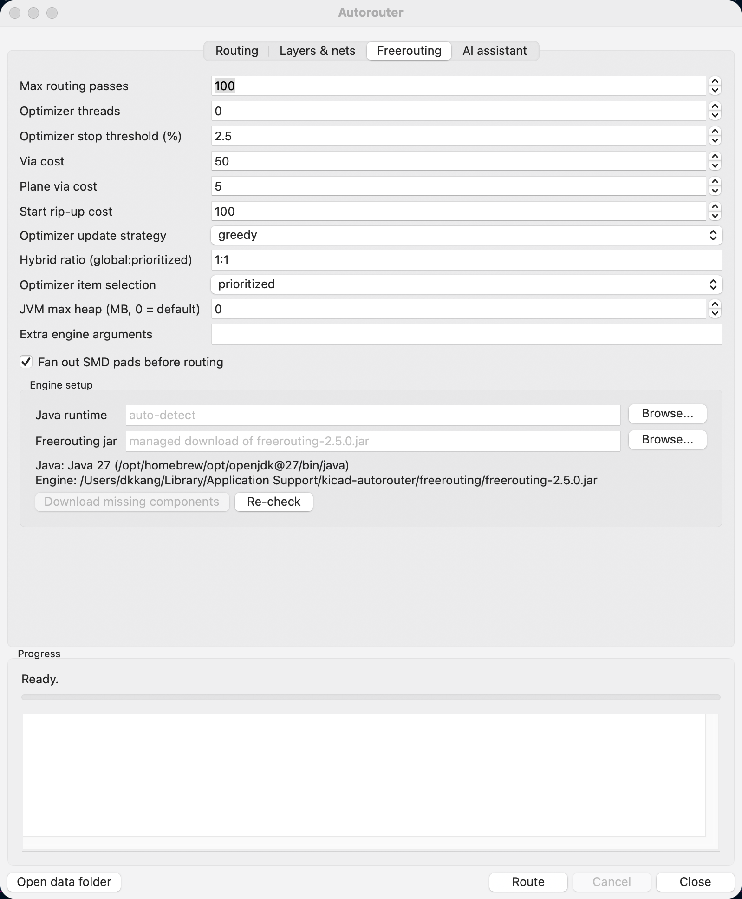

# KiCad Autorouter

Autoroute the open board without leaving KiCad's PCB editor. One toolbar
button opens a dialog with two routing engines and an AI assistant:

- **Built-in router** (default). Reads pads, existing copper, keepouts, the
  board outline and the net-class rules through KiCad's PCB API, routes on a
  multi-layer grid with A* and rip-up, and puts each connection's tracks and
  vias on the board **as soon as it is found**. No files, no external
  programs, one undo step. It escapes pads along their axis, necks down at
  fine-pitch pins, routes differential pairs coupled, fans GND/power pads out
  to their planes, stitches pours with vias and refills the zones.
- **Freerouting**. The classic Java autorouter, driven headless: Specctra DSN
  out, session back in, pass-by-pass progress in the dialog. The jar and, if
  needed, a Java runtime are downloaded into the plugin's data folder on
  first use.
- **AI assistant**. Hands the board to the OpenAI Codex CLI and carries out
  what it answers: option changes, routing by net, sheet or selection,
  removing or adding tracks and vias, with the DRC fed back each round.


## Requirements

- KiCad 9.0 or 10.0 (the SWIG action-plugin API). KiCad 11 drops that API; an
  IPC-API build is on the roadmap.
- The built-in router needs nothing else.
- Freerouting needs internet access on first use (about 120 MB: engine 62 MB,
  JRE 55 MB), or a Java 25+ runtime already on the machine and a copy of
  `freerouting-2.5.0.jar`.
- The AI assistant needs the `codex` CLI (`npm i -g @openai/codex`), logged in.
- macOS (Apple Silicon and Intel), Windows x64, Linux x64/arm64.

## Installation

### With the Plugin and Content Manager (recommended)

1. In KiCad: **Plugin and Content Manager → Manage… → Add Repository**, paste
   ```
   https://raw.githubusercontent.com/hulryung/kicad-autorouter-pcm/main/repository.json
   ```
2. Switch the repository dropdown to **KiCad Autorouter Repository**, select
   **Autorouter**, **Install**, then **Apply Pending Changes**.
3. The *Autorouter* button appears in the PCB editor's toolbar
   (**Tools → External Plugins** lists it too). The PCM also tells you when a
   newer version is published.

The source repository is private; the PCM repository above holds only the
installable packages and their metadata. Maintainers publish a new version with
`python3 scripts/publish-pcm.py` after bumping `__version__` and `metadata.json`.

### From a zip

`python3 scripts/build-package.py` writes `release/kicad-autorouter-<version>.zip`;
**Plugin and Content Manager → Install from File…** installs it.

### For development

```bash
git clone https://github.com/hulryung/kicad-autorouter
cd kicad-autorouter
./scripts/install-dev.sh      # symlinks plugins/autorouter into KiCad 9/10's scripting/plugins
touch plugins/autorouter/.devreload   # optional: reload edited modules on every run, no KiCad restart
```

Then **Tools → External Plugins → Refresh Plugins** in the PCB editor.

## Using it

Open a board, click **Autorouter**, pick an engine, click **Route**. Options
are remembered between runs, and every run is one undo step (Ctrl+Z puts the
board back exactly as it was).

| Tab | What you set |
|-----|--------------|
| **Routing** | The engine. For the built-in router: routing grid pitch, via cost, search budget per connection, nets to leave to the pours (patterns such as `GND,*_PLANE`), **track width** (automatic, net class, the editor's current choice, or any pre-defined size), **via size**, vias on/off, retry pass, **fanout vias** for GND/power pads, **coupled differential pairs**, **GND via stitching** with its pitch, **power pours** (pad vias and coarser stitching), and **what to route**: the whole board, the items selected in the editor, or the footprints of chosen schematic sheets. Whether to remove the existing tracks first and whether to refill the zones when done. |
| **Layers & nets** | Which copper layers may be routed, an optional preferred-direction override per layer, and net classes to leave unrouted. Both engines honour these. |
| **Freerouting** | Passes, optimizer threads and threshold, via / plane-via / rip-up costs, strategies, JVM heap, extra arguments, SMD fanout, and where Java and the jar come from (leave empty for auto-detection and the managed download). |
| **AI assistant** | A request in plain words, the model, the round limit, whether to include the DRC, and the **Review current routing** button for a critique without changes. |




### What the result looks like

A finished 4-layer board (71 footprints, 75 nets, DRC clean) with all its
tracks removed and rerouted by the built-in router, GND left to the pours:

| Original artwork | Rerouted by the plugin |
|---|---|
|  |  |

The cost model and the pad escapes matter for how the result looks. The LED
resistors below were first routed with a flawed diagonal cost (left: a
zig-zag "bus") and, after the fix plus escapes toward the net's nearest pad,
as a designer would draw them (right):

| Before | After |
|---|---|
|  |  |

Benchmark figures for that board (GND nets excluded), from
`tests/test_native_e2e.py`:

| | Original | Built-in router |
|---|---|---|
| Open signal connections | 0 | 1 of 104 (after the finer second pass) |
| DRC violations | 0 | 0 |
| Track segments | 353 | 469 |
| Track length | 764 mm | 901 mm |
| Vias | 46 | 65 (36 of them pad-to-plane fanout) |
| Stitching vias (GND pours, 4 mm) | – | 161 |

## KiCad's routing settings

The built-in router takes its sizes from the board the way KiCad's own tools
do:

- **Net classes**: track width, clearance, via diameter and drill come from
  each net's effective net class. Board minimums (track width, via size,
  clearance, hole clearance, hole-to-hole) are enforced on top.
- **Per-item clearances**: pads and tracks with local clearance overrides are
  kept at that distance.
- **Automatic track width** (the default): an explicit net class wins; else
  the width the net's existing tracks already use; else, for power nets
  (names like `+3V3`, `VBUS`, `VCC*`, `*_PWR`), the widest pre-defined width
  that still fits the net's narrowest pad; else the net class width.
- **Pre-defined sizes and the editor's selection** are offered as alternatives
  for track width and via size.
- **Differential pairs**: nets paired by name (`D+/D-`, `TX_P/TX_N`,
  `USB_DP/USB_DN`) take the pair width and gap of their net class, which is
  where KiCad keeps the impedance choice (Board Setup > Net Classes), and are
  routed coupled: one search for the pair's centreline, then the two tracks a
  gap apart, each joined to its pad with a straight run and a 45-degree step.
  Pairs whose ends are closer than 3 mm, whose pins would force a crossing,
  or whose halves would pinch are routed separately, and the log says why.

Not read yet: custom DRC rules (`.kicad_dru`) that set track width or via size
per condition (their clearances are honoured through the per-item clearance).

## Routing part of a board

*What to route* on the Routing tab:

- **Selected items**: select footprints, pads, tracks or vias in the editor
  before opening the dialog. Connections that touch a selected footprint, and
  all connections of a selected track's or via's net, are routed.
- **Schematic sheets**: tick one or more sheets. Connections touching a
  footprint from those sheets are routed.

Only the chosen connections are searched; the rest of the board stays an
obstacle.

## How the built-in router works

1. **Read** (PCB API, a few seconds): every pad, track, via, keepout and copper
   graphic is rasterized onto one occupancy grid per distinct (track width,
   clearance) pair, already inflated by the clearance plus half the track
   width (plus a 10 µm safety margin), so the search only asks "may this net's
   centreline pass here?". Pads of the same net already joined by copper form
   clusters; the connections to route are a minimum spanning tree over each
   net's clusters, like KiCad's ratsnest.
   - **Pad escapes**: SMD pads are left along the pad's long axis to an exit
     point just past the pad end, towards the net's nearest other pad when
     that lane is free; each lane is checked with KiCad's own shape collision
     tests and lanes are kept clear of each other.
   - **Fine pitch**: connections that end on fine-pitch pins (neighbours
     closer than width + 2 × clearance) are routed first and at the board's
     narrowest pre-defined width for their whole length.
2. **Route** (worker thread): multi-source, multi-layer A* (8 directions, no
   corner cutting, preferred direction per layer, a diagonal costs its share
   of the against-direction penalty so runs do not zig-zag, via cost, turn
   penalty). A connection that cannot be routed gets a **rip-up and reroute**
   pass: a search that may cross paths this run created (never fixed copper)
   at a penalty, those paths are removed, the connection is routed, and the
   removed ones are rerouted. Zig-zag runs are straightened into one straight
   and one diagonal piece. Differential pairs go first, as one coupled route.
   Connections still open after that get a **second pass** on their own: half
   the grid pitch, the board's narrowest pre-defined width, cheaper vias, in a
   run scoped to just those nets, the way a designer finishes the last
   stubborn connections by hand.
3. **Finish**: pads of unrouted pour nets get **fanout vias** to their planes,
   pours spanning two or more layers get **stitching vias** on a grid, both
   only where a via still fits; copper zones are refilled.
4. **Apply** (PCB API, main thread): each path becomes `PCB_TRACK` segments and
   through `PCB_VIA`s, added to the open board as it is found; ripped-up paths
   are removed again. KiCad records the whole run as one undo step.

Limits: through vias only; filled zones are not obstacles (they are refilled
around the new tracks, so pour nets belong under *Nets to leave unrouted*); the
grid is uniform, so very fine-pitch parts want a smaller pitch (slower).

## AI assistant (Codex)


The **AI assistant** tab hands the board to the OpenAI Codex CLI and carries
out what it answers. Write the request in plain words ("route the whole board,
leave GND to the pours, keep the USB pair coupled, then fix what the DRC
reports"), or press **Review current routing** for a critique without changes.

Each round the plugin writes `board-context.json` (board size and layers,
rules and pre-defined sizes, net classes, every net with its pads, class,
tracks, pours and pair partner, footprints per sheet, the options, the last
run's outcome, and KiCad's DRC on a refilled copy) and runs

```
codex exec --skip-git-repo-check -s read-only --ephemeral --output-schema <schema> -o <reply> -
```

with the request, the context and a rendered image of the board on stdin.
The model must answer with a JSON object (schema enforced by Codex): a
`summary`, `done`, and `actions`:

| Action | What it does |
|---|---|
| `set_options` | change routing options for the next route (grid, via cost, skip nets, widths, layers, fanout, stitching, pairs, ...) |
| `route` | run the built-in router on the board, a list of nets, schematic sheets or the selection, with hints: allowed `layers`, a fixed `width_mm`, `via_cost`, `avoid_mm` rectangles |
| `remove_tracks`, `remove_items_near` | delete a net's copper, or the tracks/vias around a point |
| `add_track`, `add_via` | draw copper by hand (polyline in mm, via at a point) |
| `move_footprint` | move, rotate or flip a part |
| `move_items_near`, `set_track_width`, `set_layer_near`, `set_via_near` | shift existing tracks/vias, change widths, move segments to another layer, resize vias |
| `inspect_near` | list the tracks, vias, pads and footprints around a point (returned to the model) |
| `refill_zones`, `note`, `ask` | refill pours, leave a remark, ask the user (the loop stops) |

The plugin applies them on the open board through the built-in router with
live display. **Every edit is measured**: KiCad's DRC and the unconnected
count are taken before and after, hand edits that add violations are rolled
back automatically (unless the model sets `force` because a later action will
fix it), and each round's results, the `failed_detail` of connections that
could not be routed (how much room there is around each end and which nets
block it), a fresh DRC and a new board image go back to the model, up to the
round limit or until `done`. The whole session stays one undo step. The
sandbox is read-only and the working directory is the plugin's job folder
(context, prompts, replies, images and `rounds.json` stay there), so the
model can read the context files but nothing else is touched.
`docs/ai-routing-approach.md` explains the design and the plan for it.

## How it is built

```
plugins/autorouter/
  __init__.py        registers the action plugin (skipped outside the PCB editor)
  plugin.py          pcbnew.ActionPlugin: the toolbar button (.devreload hook for development)
  dialog.py          wx dialog: engines, options, scopes, progress, the AI tab
  settings.py        settings.json in the data folder
  engine/
    native/          the built-in router
      extract.py     board -> RoutingProblem through pcbnew (pads, copper, keepouts, outline, rules,
                     escapes, pairs, fanout and stitching candidates, scopes)
      grid.py        multi-layer owner grid and rasterizers
      astar.py       one connection: multi-source, multi-layer A*, soft mode for rip-up
      router.py      all connections: order, rip-up, pairs, straightening, fanout, stitching
      apply.py       RoutedPath -> PCB_TRACK / PCB_VIA on the board
      problem.py     the data model shared by the above
    ai/              the Codex assistant: context.py, codex.py, actions.py, assistant.py, headless.py
    freerouting.py   Freerouting release pin, jar lookup/download, options -> command line
    java.py          find a Java >= 25 or install a Temurin JRE into the data folder
    runner.py        the engine subprocess on a worker thread
    progress.py      Freerouting log lines -> stage / pass / unrouted / violations
    session.py       the pcbnew side of Freerouting: DSN export, SES import, zone refill, job folders
    download.py      download with progress, sha256 check, safe archive extraction
    paths.py         data folder and platform names
```

Only `extract.py`, `apply.py`, `session.py`, `context.py`, `plugin.py` and
`dialog.py` import pcbnew or wx; everything else runs and is tested with a
plain Python.

### Data folder

| OS | Path |
|----|------|
| macOS | `~/Library/Application Support/kicad-autorouter` |
| Windows | `%LOCALAPPDATA%\kicad-autorouter` |
| Linux | `$XDG_DATA_HOME/kicad-autorouter` (default `~/.local/share/kicad-autorouter`) |

It holds `freerouting/`, `jre/`, `jobs/` (each run's files: DSN/SES, the AI
context, prompts and replies; last 10 kept), `logs/` and `settings.json`.

## Tests

```bash
python3 scripts/run-tests.py        # offline: router core on synthetic grids (incl. a coupled pair),
                                    # command line, progress parser, settings, AI schema and loop (fake codex)
# with KiCad's Python the end-to-end tests run too:
/Applications/KiCad/KiCad.app/Contents/Frameworks/Python.framework/Versions/Current/bin/python3 scripts/run-tests.py
# the built-in router on any board, with KiCad's DRC and artwork statistics:
<KiCad python3> tests/test_native_e2e.py path/to/board.kicad_pcb --skip GND --out /tmp/routed
# the assistant against the real Codex CLI (opt-in):
KICAD_AUTOROUTER_AI_LIVE=1 <KiCad python3> tests/test_ai_live.py [board] [request]
```

## Roadmap

- Built-in router: a congestion analysis for failed connections, blind/buried
  vias, zone-aware routing, reference-artwork style profiles once reference
  boards are available.
- AI assistant: a rendered board image per round, waypoint and layer-preference
  routing primitives with DRC-checked rollback (see `docs/ai-routing-approach.md`).
- **KiCad 11 / IPC API build.** KiCad 11 removes the SWIG plugin API; the
  router's board reading and track writing move to `kicad-python`.

## License

MIT for the plugin. Freerouting is GPL-3.0 and is downloaded from its own
releases at run time; it is not part of this package.
